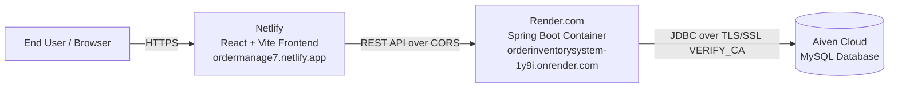

# Order Inventory System

A production-ready, full-stack Order & Inventory Management System featuring a modern React frontend, a resilient Spring Boot RESTful backend, and a cloud-managed MySQL database with TLS/SSL encryption.

---

## 🚀 Live Working Project

| Service | Hosting Provider | Live URL |
| :--- | :--- | :--- |
| **Frontend Application** | **Netlify** | [https://ordermanage7.netlify.app/](https://ordermanage7.netlify.app/) |
| **Backend REST API** | **Render** | [https://orderinventorysystem-1y9i.onrender.com](https://orderinventorysystem-1y9i.onrender.com) |
| **API Health Check** | **Render** | [https://orderinventorysystem-1y9i.onrender.com/api/health](https://orderinventorysystem-1y9i.onrender.com/api/health) |
| **Database** | **Aiven** | Cloud-managed MySQL (SSL / TLS Encrypted) |
| **Low-Level Design (LLD)** | **Notion** | [View LLD on Notion](https://foil-poinsettia-75d.notion.site/Order-Inventory-74bdd4829f9f4e41a25a510e7c5dd6f8) |


---

## 🏗️ Architecture & Deployment

The application is architected as a decoupled, multi-cloud system:



### 1. Frontend Deployment — Netlify
- **Platform**: [Netlify](https://www.netlify.com/)
- **Live URL**: `https://ordermanage7.netlify.app/`
- **Build Settings**:
  - **Base directory**: `frontend`
  - **Build command**: `npm run build`
  - **Publish directory**: `frontend/dist` (or `dist` if root is set to `frontend`)
- **Environment Variables**:
  ```env
  VITE_API_URL=https://orderinventorysystem-1y9i.onrender.com
  ```
- **SPA Routing Configuration**:
  - A `_redirects` file is included in `frontend/public/` to prevent 404 errors on browser page reloads:
    ```text
    /*    /index.html   200
    ```

---

### 2. Backend Deployment — Render
- **Platform**: [Render](https://render.com/)
- **Live URL**: `https://orderinventorysystem-1y9i.onrender.com`
- **Service Type**: Web Service (Docker)
- **Deployment Details**:
  - **Root Directory**: `OrderInvertory`
  - **Dockerfile**: `OrderInvertory/Dockerfile`
  - Multi-stage Docker build with Eclipse Temurin Java 21 and Maven 3.9.
  - Dynamically binds to Render's injected `$PORT` environment variable (`server.port: ${PORT:8080}`).
  - **CORS Handling**: Configured with `allowedOriginPatterns("*")` and a high-precedence `CorsFilter` to support cross-origin requests from Netlify and local environments seamlessly.
- **Environment Variables (Render Dashboard → Environment)**:
  ```env
  SPRING_DATASOURCE_URL=jdbc:mysql://<AIVEN_HOST>:<AIVEN_PORT>/db?sslMode=VERIFY_CA&serverTimezone=UTC&allowPublicKeyRetrieval=true
  SPRING_DATASOURCE_USERNAME=avnadmin
  SPRING_DATASOURCE_PASSWORD=<AIVEN_PASSWORD>
  CORS_ALLOWED_ORIGINS=*
  ```

---

### 3. Database — Aiven for MySQL
- **Platform**: [Aiven Cloud](https://aiven.io/)
- **Database Engine**: MySQL 8.x
- **Security & SSL/TLS Configuration**:
  - Enforced SSL mode: `sslMode=VERIFY_CA`.
  - The public Aiven CA certificate (`ca.pem`) is baked into the Docker image's JVM truststore (`cacerts`) at build time via `keytool`:
    ```dockerfile
    COPY ssl/ca.pem /tmp/aiven-ca.pem
    RUN keytool -importcert -noprompt -alias aiven-ca \
        -file /tmp/aiven-ca.pem \
        -keystore "${JAVA_HOME}/lib/security/cacerts" \
        -storepass changeit && rm /tmp/aiven-ca.pem
    ```
  - This eliminates runtime secret-mounting dependencies and ensures zero connection failures during auto-deploys.

---

## ✨ Features

- **Dashboard**: High-level metrics, summary cards, and quick navigation.
- **Customer Management**: Complete CRUD, search by email/name wildcard, shipment status counts, and order histories.
- **Product Catalog**: View products, pricing, and category categorization.
- **Order Processing**: View, track, and filter customer orders and fulfillment statuses.
- **Inventory Tracking**: Stock levels across multiple fulfillment stores and warehouse locations.
- **Shipments**: Track shipment states (Pending, Shipped, Delivered, Overdue).
- **Responsive UI**: Built with Material UI and Tailwind CSS for mobile, tablet, and desktop views.

---

## 🛠️ Tech Stack

### Frontend
- **Framework**: [React 19](https://react.dev/) + [Vite](https://vitejs.dev/)
- **UI Components**: [Material UI (MUI v7)](https://mui.com/)
- **Data Tables**: [@mui/x-data-grid](https://mui.com/x/react-data-grid/)
- **Styling**: [Tailwind CSS v4](https://tailwindcss.com/) + Emotion
- **Routing**: [React Router DOM v7](https://reactrouter.com/)

### Backend
- **Framework**: [Spring Boot 3.5](https://spring.io/projects/spring-boot)
- **Language**: Java 21
- **Persistence**: Spring Data JPA & Hibernate
- **Database Driver**: MySQL Connector/J
- **API Documentation**: SpringDoc OpenAPI / Swagger UI

---

## 📡 Key REST API Endpoints

| Method | Endpoint | Description |
| :--- | :--- | :--- |
| `GET` | `/api/health` | Service health status |
| `GET` | `/api/v1/customers` | Fetch all customers |
| `POST` | `/api/v1/customers` | Create a new customer record |
| `PUT` | `/api/v1/customers` | Update an existing customer record |
| `DELETE` | `/api/v1/customers/{id}` | Delete a customer record |
| `GET` | `/api/v1/customers/{email}` | Search customer by email |
| `GET` | `/api/v1/customers/name/{name}` | Search customer by name |
| `GET` | `/api/v1/customers/{id}/order` | Get customer with order details |
| `GET` | `/api/v1/customers/{id}/shipment` | Get customer shipment history |
| `GET` | `/api/v1/customers/shipments/pending` | Fetch customers with pending shipments |
| `GET` | `/api/v1/customers/shipments/overdue` | Fetch customers with overdue shipments |
| `GET` | `/api/v1/orders` | Fetch all orders |
| `GET` | `/api/v1/products` | Fetch product catalog |
| `GET` | `/api/v1/inventory` | Fetch inventory stock levels |

---

## 💻 Local Development Setup

### Prerequisites
- Node.js (v18+)
- Java JDK 21
- Docker & Docker Compose (optional for local containerization)

### 1. Run Backend Locally
```bash
cd OrderInvertory
./mvnw clean spring-boot:run
```
The backend starts on `http://localhost:8080`.

### 2. Run Frontend Locally
```bash
cd frontend
npm install
npm run dev
```
Visit `http://localhost:5173` in your browser.

### 3. Run Everything with Docker Compose
```bash
# Copy and configure environment variables
cp .env.example .env

# Start containers
docker compose up --build -d
```

---

## 📄 License
This project is open-source and licensed under the [MIT License](LICENSE).
